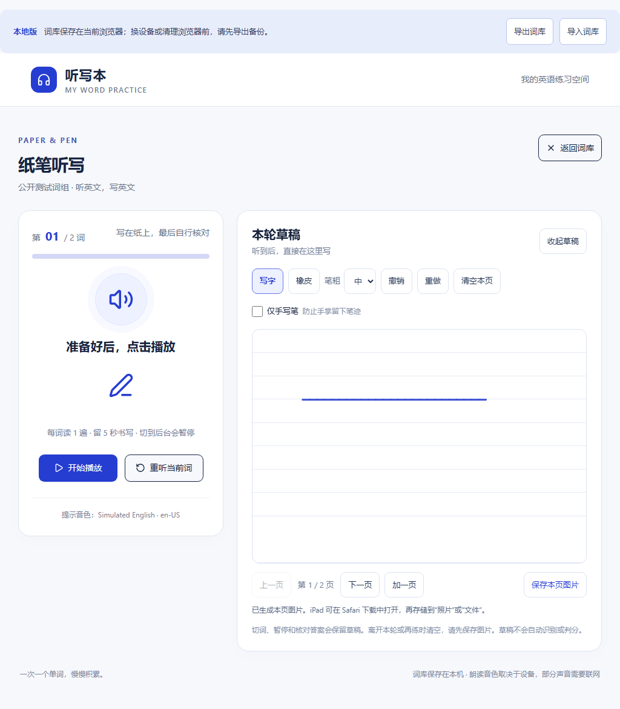
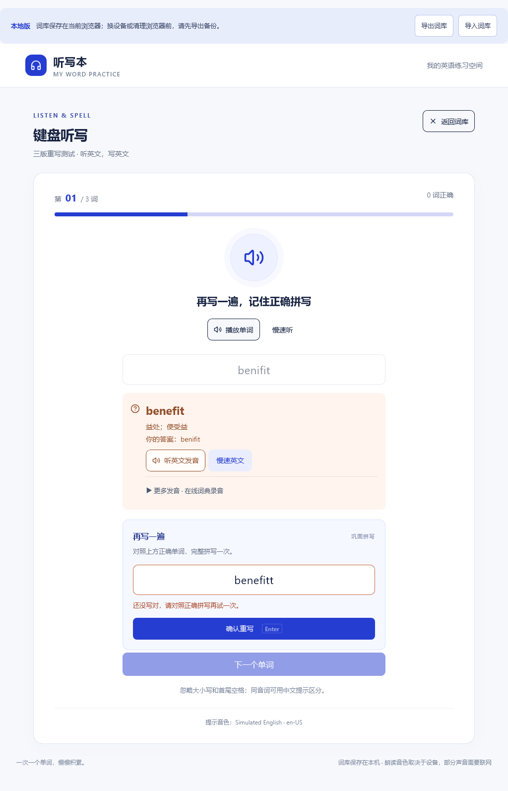
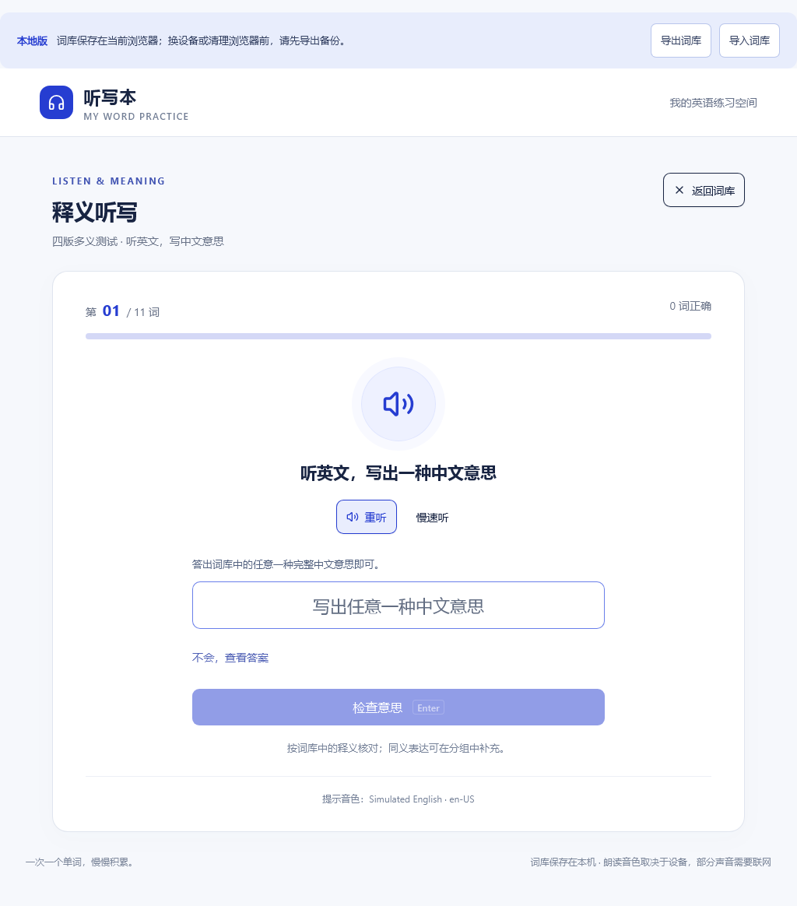
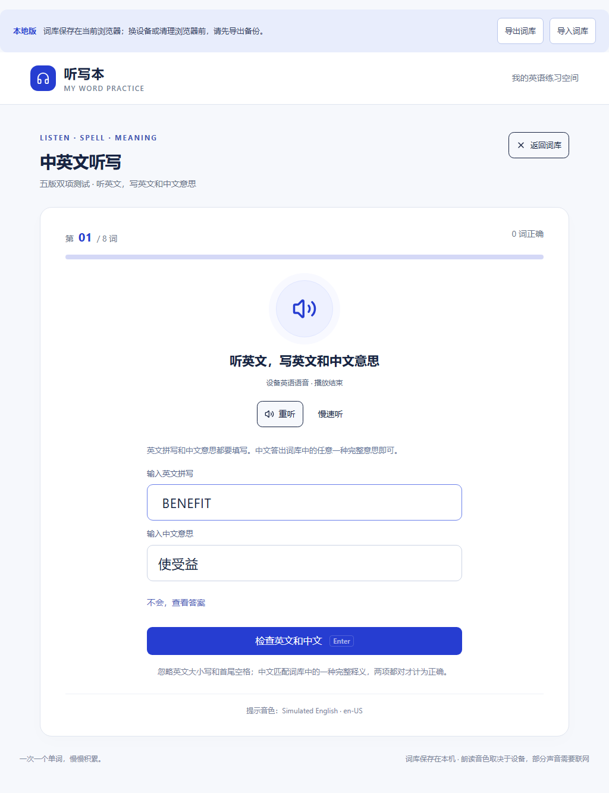
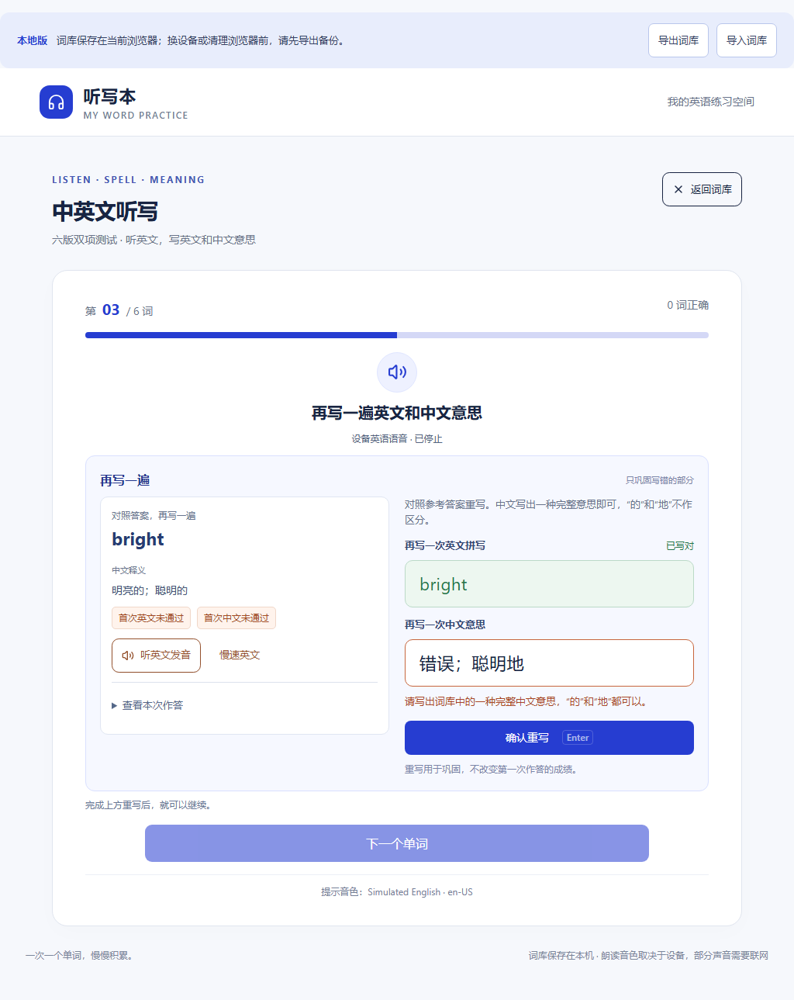
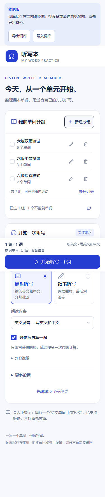

# 听写本 · 英语单词听默写

把课本单元的单词录进来，键盘听写英文拼写、在横线纸上纸笔听写，或者听英文写中文意思，也可以听一个英文单词同时写下英文拼写和中文意思，答错的项还能要求重写一遍。**单文件网页应用，可安装到 iPad / iPhone 主屏幕，装好后离线也能用。**

An offline-capable, single-file English vocabulary dictation web app (PWA) for iPad / iPhone / desktop. UI is in Chinese.

## 👉 在线使用

| 版本 | 地址 | 特点 |
| --- | --- | --- |
| **原版** | **https://hongcheng20071024-maker.github.io/tingxieben/** | 键盘听写：听到发音，输入拼写，即时批改 |
| **v2 · 草稿纸** | **https://hongcheng20071024-maker.github.io/tingxieben/v2/** | 纸笔听写：手指 / Apple Pencil 在横线纸上手写、橡皮、撤销重做、多页、保存 PNG，草稿旁带播放控制 |
| **v3 · 错词重写** | **https://hongcheng20071024-maker.github.io/tingxieben/v3/** | 键盘听写 + **答错后再写一遍**（默认开启，可关）：拼错或点「不会，查看答案」后保留原答案与正确拼写，**写对才能进入下一词**；成绩仍按第一次作答计算。同时包含 v2 的纸笔草稿纸 |
| **v4 · 听英文写中文意思** | **https://hongcheng20071024-maker.github.io/tingxieben/v4/** | 在键盘听写里新增「**英文发音 → 写中文意思**」：写对词库里录入的任意一种释义即可，多义词（`bank 银行；河岸`）答对任一个都算；检查后给出参考释义，可重听。含 v2 草稿纸与 v3 错词重写 |
| **v5 · 中英文双听写** | **https://hongcheng20071024-maker.github.io/tingxieben/v5/** | 新增「**英文发音 → 写英文和中文**」：一个单词分别填英文拼写和任意一种完整中文意思，**两项都对才算这一词正确**，成绩分列拼写与意思两项；首页还能选「发音资源」——设备语音 / 美式词典录音 / 英式词典录音（在线录音来自 Free Dictionary API，**只发送当前单词**，断网或查不到所选口音时自动回退设备发音）。含前面各版的全部功能。**2026-10-13 打磨版**：发音状态与「更多发音设置」收拢为单行、答后反馈一并显示英文与中文两项判定并收起输入框、答后可展开「其他收录录音」手动试听 |
| **v6 · 中英文错词重写** | **https://hongcheng20071024-maker.github.io/tingxieben/v6/** | 「**错哪项、重写哪项**」：四种键盘听写方向共用一个「答错后再写一遍」开关 —— 听英文写英文 / 听中文写英文重写英文，听英文写中文重写一种完整中文意思，听英文写英文和中文则**只重写答错的那一项**（两项都错就分次重写，写对的一项保留）；点「不会，查看答案」后重写当前方向的全部内容。中文判分新增「**的／地**」兼容（词库写「拼命地」，答「拼命的」也算对；「得」未并入）。在线发音失败的原因说明更准确。含前面各版全部功能 |
| **v6.1 · 体验优化** | **https://hongcheng20071024-maker.github.io/tingxieben/v6-1/** | 在 v6 上做体验打磨：**重写两项时按 Enter 先跳到下一个输入框**（不提前报中文错），最后一个待填框按 Enter 或点「确认重写」才整表检查；**首页新增开始栏** —— 一处显示本轮所选分组、去重后总词数、听写方向、重写开关与发音来源，电脑放在设置上方、手机固定在底部，开始被禁用时就近说明原因；**答错的参考答案、发音与重写输入合并到同一区域**（宽屏两栏、手机上下排列），首次作答收进「查看本次作答」。含 v6 与前面各版全部功能 |

七个版本**各自独立，可以同时装七个主屏幕图标**；在同一个浏览器、同一个站点下**共用同一份本地词库**，换版本不用重新导入。
第一次用建议先联网打开原版，再联网打开要用的新版（原因见 [docs/v2草稿纸.md](docs/v2草稿纸.md)、[docs/v3错词重写.md](docs/v3错词重写.md)、[docs/v4中英文听写.md](docs/v4中英文听写.md) 、[docs/v5中英文双听写.md](docs/v5中英文双听写.md)、[docs/v6中英文错词重写.md](docs/v6中英文错词重写.md) 与 [docs/v6-1体验优化.md](docs/v6-1体验优化.md)）。

<p align="center">
  
  
  
  
  
  
  
  <br>
  <sub>左：扫码打开原版（也可以截图发给同学）　v2 的 iPad 草稿纸　v3 的答错后重写　v4 的听英文写中文意思　v5 的听英文写英文和中文　v6.1 的合并答案卡与手机开始栏</sub>
</p>

---

## 装到 iPad / iPhone

1. 用 **Safari** 打开上面的网址（必须是 Safari，微信内置浏览器不行）。
2. 点 **分享**（方框 + 向上箭头）→ **添加到主屏幕** → **添加**。
3. 主屏幕出现「听写本」图标，点开即全屏使用。

首次打开需要联网，之后离线可用（Service Worker 已缓存整站）。
如果 iPad 上找不到「分享」按钮，把 Safari 地址栏往下拉一下就会出现。

**安卓 / 电脑**：Chrome / Edge 打开同一个网址，菜单里选「安装应用」或「添加到主屏幕」。

## 词库

- 应用内可以自己增删单词，按单元（分组）管理。
- **导出 / 导入**：把词库导出成 JSON 存到「文件」App 或网盘，换设备时在新设备导入即可。
- 数据存在**你自己设备**的浏览器里（localStorage，key 为 `listen-write-library-v1`），不会上传到任何服务器。
- 原版、v2、v3、v4、v5、v6、v6.1 在**同一站点**下共用这份词库（localStorage 按站点共享），可以随时来回切换。
- 页面首次打开时会预置一个单元「大学英语Unit1」（27 词），仅当浏览器里还没有任何词库时写入。
- 用 AI 批量生成词库、或自己手写词库文件：格式见 **[docs/词库格式.md](docs/词库格式.md)**（内含可直接复制给 ChatGPT 的提示词模板）。
- v4 的**多义词**：同一行用分号（或逗号、顿号、斜杠、竖线）分开写多种释义，例如 `bank 银行；河岸`，答对任意一种都算对。词性标记（`n.` `vt.` `adj.`）和编号会自动整理，`（河）岸` 可以答「岸」或「河岸」。

⚠️ 换设备**不会**自动同步；清理浏览器数据前请先导出备份；不要长期用无痕模式。

## 发音没声音？

朗读用的是系统语音包（Web Speech API）。没有声音时：

- **iPad**：设置 → 辅助功能 → 朗读内容 → 声音 → 英语，下载一个英语语音包。
- 应用里「更多声音与语音包」有官方指引入口。

## 目录结构

| 路径 | 说明 |
| --- | --- |
| `index.html` | **原版部署成品**（由原始源码注入 PWA 配置生成） |
| `v2/index.html` | **v2 草稿纸成品**（先生成原版成品，再把草稿纸内联进去） |
| `v2/manifest.webmanifest`、`v2/sw.js`、`v2/icon-*.png` | v2 的应用清单、离线缓存、图标（都限定在 `v2/` 目录内） |
| `v3/index.html` | **v3 错词重写成品**（由原始源码打补丁 + 注入草稿纸与订正组件生成） |
| `v3/manifest.webmanifest`、`v3/sw.js`、`v3/icon-*.png` | v3 的应用清单、离线缓存、图标（都限定在 `v3/` 目录内） |
| `v4/index.html` | **v4 中英文听写成品**（由原始源码打 v3 + v4 补丁 + 注入草稿纸、订正组件与释义判分生成） |
| `v4/manifest.webmanifest`、`v4/sw.js`、`v4/icon-*.png` | v4 的应用清单、离线缓存、图标（都限定在 `v4/` 目录内） |
| `v5/index.html` | **v5 中英文双听写成品**（由原始源码打 v3 + v4 + v5 补丁 + 注入草稿纸、订正组件、释义判分与双项听写生成） |
| `v5/manifest.webmanifest`、`v5/sw.js`、`v5/icon-*.png` | v5 的应用清单、离线缓存、图标（都限定在 `v5/` 目录内） |
| `v6/index.html` | **v6 中英文错词重写成品**（由原始源码打 v3 + v4 + v5 + v6 补丁 + 注入草稿纸、订正组件、释义判分、双项听写与按方向重写生成） |
| `v6/manifest.webmanifest`、`v6/sw.js`、`v6/icon-*.png` | v6 的应用清单、离线缓存、图标（都限定在 `v6/` 目录内） |
| `v6-1/index.html` | **v6.1 体验优化成品**（由原始源码打 v3 + v4 + v5 + v6 补丁，再打 v6.1 首页 2 处 + 会话 8 处补丁生成） |
| `v6-1/manifest.webmanifest`、`v6-1/sw.js`、`v6-1/icon-*.png` | v6.1 的应用清单、离线缓存、图标（都限定在 `v6-1/` 目录内） |
| `source/听写本.html` | **原始单文件源码**（初版，未注入 PWA，所有版本都从它构建） |
| `source/scratchpad.js`、`source/scratchpad.css` | v2 草稿纸的源码（构建时内联） |
| `source/rewrite-spelling.js`、`source/rewrite-spelling.css` | v3 错词重写的源码（构建时内联） |
| `source/meaning-grader.js` | v4 中文释义判分逻辑（构建时内联进 React 作用域） |
| `source/meaning-mode.js`、`source/meaning-mode.css` | v4「听英文写中文意思」模式的界面与接入源码（构建时内联） |
| `source/dual-mode.js`、`source/dual-mode.css` | v5「听英文写英文和中文」双项模式的界面与接入源码（构建时内联） |
| `source/audio-v5.js`、`source/audio-v5.css` | v5 发音资源（设备语音 / 在线词典录音、来源与许可展示、回退逻辑）的源码（构建时内联） |
| `source/v3-patches.json` | v3 对原版 HTML 的 9 处接入补丁（每处要求恰好匹配一次） |
| `source/v4-patches.json` | v4 对原版 HTML 的 38 处接入补丁（每处要求恰好匹配一次） |
| `source/v5-patches.json` | v5 对原版 HTML 的 68 处接入补丁（每处要求恰好匹配一次） |
| `source/practice-v6.js`、`source/correction-v6.js`、`source/correction-v6.css` | v6「错哪项重写哪项」的练习流程与订正组件源码（构建时内联） |
| `source/meaning-grader-v6.js` | v6 中文判分升级版（「的／地」兼容）（构建时内联） |
| `source/audio-v6.js` | v6 发音恢复与失败原因说明的源码（构建时内联） |
| `source/correction-v6-1.js` | v6.1 重写卡：Enter 跳格与整表确认流程（构建时内联） |
| `source/home-v6-1.js`、`source/home-v6-1.css` | v6.1 首页开始栏、摘要与折叠设置（构建时内联） |
| `source/feedback-v6-1.js`、`source/feedback-v6-1.css` | v6.1 答后紧凑布局：参考答案、作答详情与重写并区（构建时内联） |
| `source/v6-patches.json` | v6 对原版 HTML 的 9 处接入补丁（每处要求恰好匹配一次） |
| `source/v6-1-home-patches.json`、`source/v6-1-patches.json` | v6.1 的 2 处首页补丁与 8 处会话补丁（每处要求恰好匹配一次） |
| `manifest.webmanifest` | PWA 清单：名称、图标、全屏模式 |
| `sw.js` | 原版 Service Worker：离线缓存（cache-first） |
| `icon-*.png` | 主屏幕图标（180 / 192 / 512 / maskable） |
| `library-backup-unit1.json` | 预置词库（大学英语 Unit1，27 词），可在应用内「导入词库」 |
| `tools/make_icons.py` | 生成图标（纯 Python，零依赖，不需要 Pillow） |
| `tools/build_site.py` | 构建原版：`source/听写本.html` → `index.html` |
| `tools/build_v2.py` | 构建 v2：先跑 `build_site.py`，再内联草稿纸 → `v2/index.html` |
| `tools/build_v3.py` | 构建 v3：校验原版 git blob 哈希 → 打 9 处补丁 → 内联订正组件与草稿纸 → `v3/index.html` |
| `tools/build_v4.py` | 构建 v4：校验原版 git blob 哈希 → 依次打 v3 + v4 补丁 → 内联判分、释义模式、订正组件与草稿纸 → `v4/index.html` |
| `tools/build_v5.py` | 构建 v5：校验原版 git blob 哈希 → 依次打 v3 + v4 + v5 补丁 → 内联判分、释义模式、双项模式、发音资源、订正组件与草稿纸 → `v5/index.html` |
| `tools/build_v6.py` | 构建 v6：校验原版 git blob 哈希 → 依次打 v3 + v4 + v5 + v6 补丁 → 内联判分、释义模式、双项模式、发音资源、按方向重写组件与草稿纸 → `v6/index.html` |
| `tools/build_v6_1.py` | 构建 v6.1：在前面基础上再打 v6.1 首页 2 处 + 会话 8 处补丁 → `v6-1/index.html`（只允许输出到 `v6-1/`） |
| `tools/deploy_pages.py` | 一键发布到 GitHub Pages（走 REST API，不需要 git） |
| `tools/test_scratchpad.cjs` | v2 浏览器回归测试（Playwright，17 项 × Chromium / WebKit） |
| `tools/test_rewrite.cjs` | v3 浏览器回归测试（Playwright，11 项 × Chromium / WebKit） |
| `tools/test_meaning.cjs` | v4 浏览器回归测试（Playwright，15 项 × Chromium / WebKit，含 PC / iPad 横竖屏 / iPhone 布局） |
| `tools/test_dual.cjs` | v5 双听写浏览器回归测试（Playwright，28 项 × Chromium / WebKit） |
| `tools/test_v5_regression.cjs` | v5 的旧听写方向回归测试（Playwright，16 项 × Chromium / WebKit，确认 v4 / v3 行为未被改坏） |
| `tools/test_v6.cjs` | v6 浏览器回归测试（Playwright，Chromium / WebKit） |
| `tools/test_v6_1.cjs` | v6.1 浏览器回归测试（Playwright，33 项 × Chromium / WebKit，含 PC / iPad 横竖屏 / 390·375·320 像素手机布局） |
| `tools/test_correction_v6_1_unit.cjs` | v6.1 重写流程定向单元测试（8 项） |
| `tests/v2-worker.test.cjs` | v2 离线缓存逻辑测试（`node tests/v2-worker.test.cjs`，无额外依赖） |
| `tests/v3-worker.test.cjs` | v3 离线缓存逻辑测试（含「不清理 v1/v2 缓存」断言） |
| `tests/v4-worker.test.cjs` | v4 离线缓存逻辑测试（含不清理 v1/v2/v3 缓存、不强制激活等断言） |
| `tests/meaning-grader.test.cjs` | v4 释义判分单元测试（122 项：分隔符、词性编号、同义释义、片段与反义误判、混入错误答案等） |
| `tests/v5-worker.test.cjs` | v5 离线缓存逻辑测试（含不清理 v1/v2/v3/v4 缓存、不强制激活等断言） |
| `tests/dual-grader.test.cjs` | v5 双项判分单元测试（50 项：两项组合判定、英文规范化、中文完整释义、偏好存储） |
| `tests/audio-v5.test.cjs` | v5 发音资源单元测试（32 项：口音选择、来源与许可校验、断网 / 超时 / 迟到结果回退、缓存上限） |
| `tests/meaning-grader-v6.test.cjs` | v6 中文判分单元测试（139 项：含「的／地」兼容与片段误判防护） |
| `tests/dual-grader-v6.test.cjs` | v6 组合判分与设置单元测试（50 项） |
| `tests/correction-v6.test.cjs` | v6 按方向重写单元测试（30 项） |
| `tests/audio-v6.test.cjs` | v6 发音控制与恢复单元测试（43 项） |
| `tests/v6-worker.test.cjs` | v6 离线缓存逻辑测试（含不清理 v1~v5 缓存、不强制激活等断言） |
| `tests/v6-1-worker.test.cjs` | v6.1 离线缓存逻辑测试（含不清理 v1~v6 缓存、更新、离线回退与安装失败场景） |
| `docs/词库格式.md` | 词库 JSON 格式 + 用 AI 生成词库的提示词 |
| `docs/v2草稿纸.md` | v2 说明：使用、构建、多版本共存的缓存注意事项 |
| `docs/v3错词重写.md` | v3 说明：错词重写流程、构建、验证与限制 |
| `docs/v4中英文听写.md` | v4 说明：多义词判分规则、使用、构建、验证与限制 |
| `docs/v5中英文双听写.md` | v5 说明：双项听写规则、发音资源、构建、验证与限制 |
| `docs/v5音频资源.md` | v5 发音资源说明：接入来源、来源与许可规则、回退行为、查询隐私边界 |
| `docs/v6中英文错词重写.md` | v6 说明：错哪项重写哪项、中文「的／地」兼容、构建、验证与限制 |
| `docs/v6-1体验优化.md` | v6.1 说明：Enter 跳格、首页开始栏、合并答案卡、构建、验证与限制 |
| `docs/v6-1完成记录.md` | v6.1 本批改动记录：改了什么、保持了什么规则、测试结果与未验证范围 |

## 自己部署一份

**路线 A：Fork（最省事）**

1. 点本仓库右上角 **Fork**。
2. 你 Fork 出来的仓库 → **Settings → Pages** → Source 选 **Deploy from a branch**，分支选 `main`、目录选 `/ (root)` → Save。
3. 等 1~2 分钟，访问 `https://<你的用户名>.github.io/tingxieben/`。

**路线 B：命令行（本机有 Python 就行）**

```bash
python tools/deploy_pages.py            # 需要有 GitHub 凭据（GITHUB_TOKEN 环境变量，或 git 已登录）
python tools/deploy_pages.py --repo mysite    # 换个仓库名
```

## 从源码构建

改动只发生在 `<head>`（原版）与 `<head>` + `</body>` 前（v2 / v3 / v4 / v5 / v6 / v6.1）：注入 PWA meta、启动脚本、草稿纸、错词订正、释义模式与双项听写组件，**不动原应用任何逻辑**。构建可复现 —— 同一份源码、词库、补丁与组件，每次输出完全一致。

```bash
python tools/make_icons.py       # 生成 4 个图标到仓库根目录
python tools/build_site.py       # source/听写本.html + library-backup-unit1.json → index.html
python tools/build_v2.py         # 再生成 v2/index.html（内含草稿纸）、v2/sw.js、清单与图标
python tools/build_v3.py         # 再生成 v3/index.html（内含订正组件与草稿纸）、v3/sw.js、清单与图标
python tools/build_v4.py         # 再生成 v4/index.html（内含释义判分、释义模式、订正组件与草稿纸）、v4/sw.js、清单与图标
python tools/build_v5.py         # 再生成 v5/index.html（内含双项判分、双项模式、发音资源、释义判分、订正组件与草稿纸）、v5/sw.js、清单与图标
python tools/build_v6.py         # 再生成 v6/index.html（内含按方向重写、中文判分升级、发音恢复、双项判分、发音资源、订正组件与草稿纸）、v6/sw.js、清单与图标
python tools/build_v6_1.py       # 再生成 v6-1/index.html（含 Enter 跳格、首页开始栏与合并答案卡）、v6-1/sw.js、清单与图标
node tests/v2-worker.test.cjs    # 可选：验证 v2 的离线缓存逻辑
node tests/v3-worker.test.cjs    # 可选：验证 v3 的离线缓存逻辑与版本隔离
node tests/v4-worker.test.cjs    # 可选：验证 v4 的离线缓存逻辑与版本隔离
node tests/meaning-grader.test.cjs   # 可选：122 项中文释义判分检查
node tools/test_meaning.cjs      # 可选：v4 浏览器回归（需 Playwright；TEST_ENGINE=webkit 切换内核，TEST_OUTPUT 指定报告目录）
node tests/dual-grader.test.cjs  # 可选：50 项双项判分检查
node tests/audio-v5.test.cjs     # 可选：32 项发音资源与回退检查
node tests/v5-worker.test.cjs    # 可选：验证 v5 的离线缓存逻辑与版本隔离
node tools/test_dual.cjs         # 可选：v5 双听写浏览器回归（28 项）
node tools/test_v5_regression.cjs # 可选：v5 旧听写方向回归（16 项）
node tests/meaning-grader-v6.test.cjs # 可选：139 项中文判分（含「的／地」兼容）
node tests/dual-grader-v6.test.cjs    # 可选：50 项组合判分与设置
node tests/correction-v6.test.cjs     # 可选：30 项按方向重写
node tests/audio-v6.test.cjs          # 可选：43 项发音控制与恢复
node tests/v6-worker.test.cjs         # 可选：v6 离线缓存与版本隔离
node tools/test_v6.cjs                # 可选：v6 浏览器回归
node tests/v6-1-worker.test.cjs       # 可选：v6.1 离线缓存与版本隔离
node tools/test_correction_v6_1_unit.cjs # 可选：8 项 v6.1 重写流程
node tools/test_v6_1.cjs              # 可选：v6.1 浏览器回归（33 项）
```

`tools/build_v3.py`、`tools/build_v4.py`、`tools/build_v5.py`、`tools/build_v6.py` 与 `tools/build_v6_1.py` 都会在构建前校验 `source/听写本.html` 的 Git blob SHA1，并要求补丁文件里每处补丁**恰好匹配一次**——接入点一变就停，避免静默改错。

## 已知限制

- **更新后要刷新两次**：`sw.js` 是 cache-first（为了离线可用），改了站点内容后，老用户需要重新打开一次才会拿到新版本。
- **不要改原版 `sw.js` 的缓存清理范围**：原版 Service Worker 激活时会清掉本站点下所有非自己的缓存，**包括 v2 / v3 / v4 / v5 / v6 / v6.1 的离线缓存**。当前原版 `sw.js` 已冻结，所以互不影响；如果以后动了它，用户需要「先联网开原版 → 再联网开新版」才能让新版恢复离线可用（新版会在联网导航时自动补齐缺失的离线资源）。
- **v3 的开关只存在当前浏览器**：不跟随词库同步；「答错后再写一遍」只作用于**键盘听写**的英文拼写练习，「纸笔听写」不要求订正、也不识别手写答案。
- **v3 的订正不改变成绩**：本轮成绩始终按第一次作答计算，拼错的词仍留在本轮错词里，可用「只练错词」复习。
- **v4 的判分只用词库里已录入的释义**，不联网、不调用外部语义服务：没录入的同义说法（只答「好处」而词库写的是「益处」）算错，需要在分组里补充为另一种释义。一个完整释义算一次匹配，不接受片段包含（答「益」不算「益处」，答「不需要」不算「需要」）；一次答多个释义时每个都要对。
- **v4 遇到空白 / 只有词性 / 没有中文的释义会拦下来**：页面会列出要补全的单词，不静默跳过。
- **v4 的「答错后再写一遍」只作用于英文拼写练习**，中文意思模式不要求重写。
- **v5 的在线词典录音需要联网**：选「美式 / 英式词典录音」后，每个单词会向 Free Dictionary API 查一次，**只发送当前正在播放的英文单词**（不发中文意思、答案、分组或整份词库）；查不到所选口音、来源或许可不能确认、断网、超时或播放失败时，会说明原因并回退到设备发音。录音不覆盖所有单词，本版也不下载整套离线音频包 —— 想纯离线用就把「发音资源」留在默认的「设备语音」。
- **v5 的双项判分规则**：英文拼写和中文意思**两项都对**才算这一词正确，成绩页分列显示两项正确数；中文只写一种即可，一次写多种则每种都要对；中文判分沿用 v4 规则（按词库登记的完整释义匹配，不推测未录入的同义词，不接受片段包含）。
- **v5 双项模式下，「答错后再写一遍」只管英文拼写**：只有中文意思答错可以直接进入下一词；纸笔听写也能选双项模式，但程序不识别手写内容，需自己对照核对。
- **v6 的重写跟着听写方向走**：「答错后再写一遍」在四种键盘方向共用一个开关 —— 拼写错重写英文，意思错重写一种完整中文意思，双项模式只重写答错的那一项（两项都错可分次确认，已写对的一项锁定保留）；纸笔听写仍不要求键盘重写。重写只用于巩固，**成绩始终按第一次作答计算**。
- **v6 的「的／地」兼容**：首次作答与重写都不区分「的」和「地」（词库写「拼命地」，答「拼命的」也算对）；「得」未并入。中文仍按词库登记的**完整意思**匹配，不自动推测未登记的同义词（想让「好处」也算对，请在词库里写成「益处；好处」）。
- **v6.1 的 Enter 行为**：重写两项时，在非最后一个输入框按 Enter 只跳焦点、不判分；最后一个待填框按 Enter 或点「确认重写」才整表检查。这是为了配合手机 / iPad 软键盘的输入法回车，避免刚打完英文就被判中文错误。
- **v6.1 的首页开始栏**：摘要（分组、去重后词数、方向、重写开关、发音来源）与首页选择状态共用；开始被禁用时会就近说明原因。选中的分组缺少所需中文释义时仍**阻止整轮开始**，不会静默排除这些词。
- **草稿不保存**（v2 / v3 / v4 / v5 的纸笔模式）：只在当前这一轮的内存里，切词 / 暂停 / 核对时保留，离开本轮、再练或刷新即清除；要留档就用「保存本页图片」导出 PNG（多页要逐页保存）。
- 语音与输入法行为用模拟事件测试过，未在真实 iPad、Apple Pencil 或设备音色上逐一验证；朗读音色取决于设备已安装的语音包。
- iOS 只能通过 **Safari** 添加到主屏幕；微信 / QQ 内置浏览器不支持安装。
- 词库不做云同步，靠导出 / 导入 JSON 手动搬。
- 应用本体内联了 Tailwind CSS、React 与图标库，所以 `index.html` 接近 600 KB —— 换来的是**单文件、离线可用、零依赖**。

## 许可

[MIT](LICENSE) —— 随意使用、修改、再发布，保留版权声明即可。
